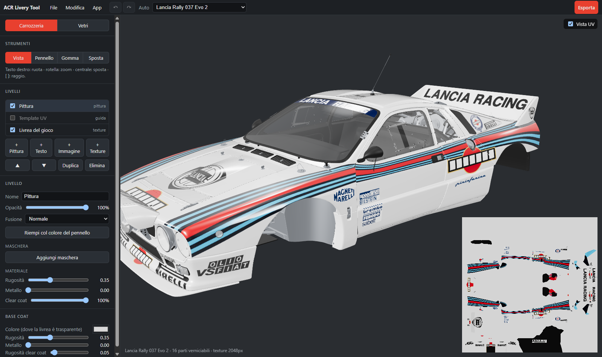

# ACR Livery Tool

*[English](README.md)*

Un editor 3D di livree per **Assetto Corsa Rally**: si dipinge direttamente sull'auto, si posano loghi,
numeri e scritte a cavallo dei pannelli e si esporta una livrea che il gioco carica.

La guida completa è nel **[wiki](https://github.com/agastal/AcrLiveryTool-Release/wiki/Installazione)**: installazione, pittura, livelli, esportazione, progetti, scorciatoie, risoluzione dei problemi.

- Tutte le 18 auto del gioco, con la loro livrea come punto di partenza e i template UV ufficiali come guida.
- Livelli con maschere, modi di fusione e rugosità, metallo e clear coat propri.
- Pennelli che lavorano in 3D (nessuna cucitura tra i pannelli): tondo, spruzzo, gesso, fibra di carbonio, timbri; simmetria
  sinistra/destra.
- Immagini (PNG, JPG, SVG) e testi proiettati sull'auto, se vuoi anche sull'altro lato.
- Annulla/ripeti, file di progetto (`.acrlivery`).
- In italiano, inglese, francese, tedesco e spagnolo.
- **Esporta** scrive la livrea in `Documenti\My Games\acr\Liveries\<auto>\<nome>\` nel formato del gioco.

## Installazione

Serve Windows 10 o 11 (64 bit) e Assetto Corsa Rally installato con Steam.

1. Scarica `AcrLiveryTool-<versione>-setup.exe` da [Releases](../../releases/latest) e avvialo (installa per il
   tuo utente, senza diritti di amministratore).
2. Il setup non ha una firma digitale di codice: Windows SmartScreen può dire "PC protetto da Windows".
   Scegli **Ulteriori informazioni → Esegui comunque**. Ogni release riporta lo SHA-256 del setup
   (`SHA256SUMS.txt`) e una scansione di Microsoft Defender di quel file (`antivirus.txt`).

## Primo avvio: preparare le auto

L'app **non contiene niente del gioco**. Al primo avvio legge le auto dalla tua installazione e le tiene in
`%LOCALAPPDATA%\acr-livery-tool\cars` (circa 5 minuti e 700 MB). Trova il gioco nelle tue librerie di Steam;
se non lo trova, *Scegli la cartella del gioco…* lo indica a mano. Dopo un aggiornamento del gioco rifallo
dall'elenco delle auto nella barra in alto, *Prepara di nuovo le auto dal gioco*.

## Usare una livrea esportata

Una cartella di livrea **nuova** il gioco la vede solo all'avvio: dopo la prima esportazione riavvia il gioco.
Riesportando con lo stesso nome, nel gioco basta scegliere un'altra livrea e tornare indietro.

## In gara con la tua livrea

ACRK Challenge organizza sfide settimanali e classifiche per i piloti di Assetto Corsa Rally: [scopri come partecipare](https://ch.acrkhotlap.workers.dev/invite?lang=it). Anche l'app ci porta (menu *App*, e dopo un'esportazione).

## Sostienila

ACR Livery Tool è gratuita. Se ti piace, puoi sostenerla con una donazione su [PayPal](https://www.paypal.com/paypalme/agastalink).

## Aggiornamenti

L'app controlla in questo repository se c'è una versione nuova all'avvio e una volta al giorno (si può
spegnere dal menu *App*) e propone di installarla: scarica il setup, ne verifica la firma e si riavvia.

## Privacy

L'app non invia niente che ti riguardi. Si collega solo a:

- **GitHub, questo repository**: per sapere se c'è una versione nuova e per scaricarla quando lo chiedi;
- **GitHub, [WorkingRobot/OodleUE](https://github.com/WorkingRobot/OodleUE)**: una volta, per scaricare la
  libreria di decompressione che serve a leggere i file del gioco (tenuta in `%LOCALAPPDATA%\acr-livery-tool`).

I collegamenti ad ACRK Challenge (menu *App*, dopo un'esportazione) aprono quella pagina nel browser solo quando ci
clicchi.

Legge i file del gioco dove li ha installati Steam, o nella cartella che scegli. Scrive solo nelle sue cartelle
(`%LOCALAPPDATA%\acr-livery-tool` per le auto; `%APPDATA%\com.acrliverytool.app` e
`%LOCALAPPDATA%\com.acrliverytool.app` per le impostazioni: lingua, ultima auto, cartella del gioco, posizione
della finestra), nella cartella delle livree indicata sopra e nei file di progetto che scegli di salvare.

## Disinstallazione

Da Impostazioni di Windows → App. Le auto preparate restano in `%LOCALAPPDATA%\acr-livery-tool`: cancella
anche quella cartella per liberare lo spazio.

---

ACR Livery Tool non è affiliato a Kunos Simulazioni né a 505 Games. Assetto Corsa Rally e le sue auto
appartengono ai rispettivi proprietari.
