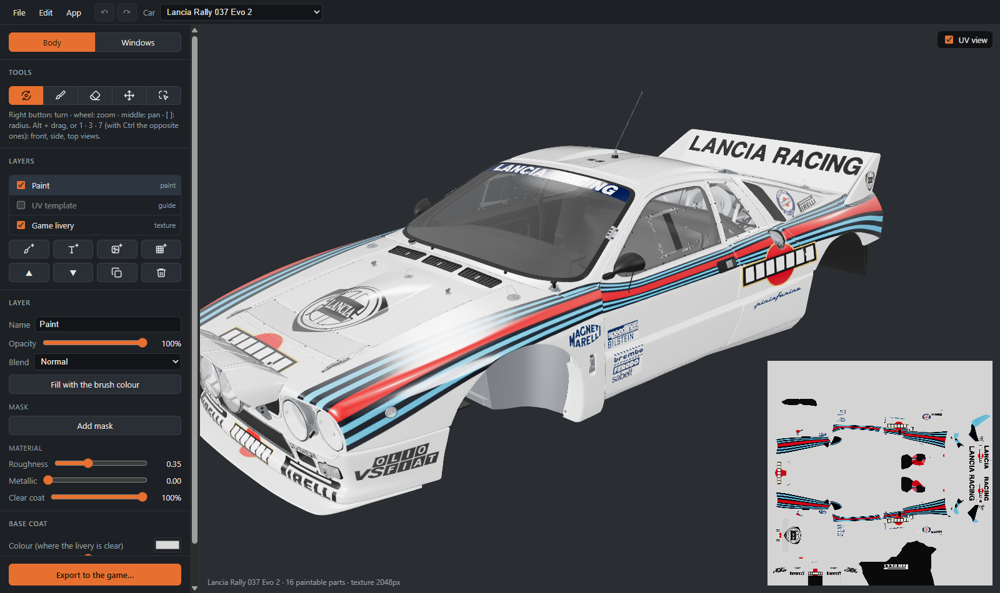

# ACR Livery Tool

*[Italiano](README.it.md)*

A 3D livery editor for **Assetto Corsa Rally**: paint straight on the car, place logos, numbers and text
across the panels, and export a livery the game loads.

The full guide is in the **[wiki](https://github.com/agastal/AcrLiveryTool-Release/wiki)**: installation, painting, layers, export, projects, shortcuts, troubleshooting.

- All 18 cars of the game, with their own livery as a starting point and the official UV templates as a guide.
- Layers with masks, blend modes and their own roughness, metallic and clear coat.
- Brushes that work in 3D (no seams between panels): round, spray, stamps; left/right symmetry.
- Images and text projected on the car, mirrored to the other side if you want.
- Undo/redo, project files (`.acrlivery`).
- In Italian, English, French, German and Spanish.
- **Export** writes the livery into `Documents\My Games\acr\Liveries\<car>\<name>\` in the game's own format.

## Install

Requirements: Windows 10 or 11 (64-bit) and Assetto Corsa Rally installed through Steam.

1. Download `AcrLiveryTool-<version>-setup.exe` from [Releases](../../releases/latest) and run it (it installs for
   your user only, no administrator rights).
2. The setup is not code-signed: Windows SmartScreen may say "Windows protected your PC". Choose
   **More info → Run anyway**. Each release lists the setup's SHA-256 (`SHA256SUMS.txt`) and a Microsoft
   Defender scan of that exact file (`antivirus.txt`).

## First start: preparing the cars

The app ships **no part of the game**. On first start it reads the cars from your own installation and keeps
them in `%LOCALAPPDATA%\acr-livery-tool\cars` (about 5 minutes and 700 MB). Do it again after a game update
from the car list in the top bar, *Prepare the cars again from the game*.

## Using an exported livery

A **new** livery folder is seen by the game only when it starts: restart the game after the first export.
Exporting again over the same name shows up in the game as soon as you select another livery and come back.

## Racing with your livery

ACRK Challenge runs weekly challenges and standings for Assetto Corsa Rally drivers: [see how to join](https://ch.acrkhotlap.workers.dev/invite?lang=en). The app links there too (*App* menu, and after an export).

## Updates

The app checks this repository for a newer release at start and once a day (it can be switched off in the
*App* menu) and offers to install it: it downloads the setup, checks its signature and restarts.

## Privacy

The app sends nothing about you anywhere. It connects only to:

- **GitHub, this repository**: to see whether there is a newer release, and to download it when you ask;
- **GitHub, [WorkingRobot/OodleUE](https://github.com/WorkingRobot/OodleUE)**: once, to download the
  decompression library the game's files need (kept in `%LOCALAPPDATA%\acr-livery-tool`).

The ACRK Challenge links (*App* menu, after an export) only open that page in your browser when you click them.

It reads the game's files where Steam installed them and writes only to its own folder, to the liveries
folder above and to the project files you choose to save.

## Uninstall

From Windows Settings → Apps. The prepared cars stay in `%LOCALAPPDATA%\acr-livery-tool`: delete that folder
too to free the space.

---

ACR Livery Tool is not affiliated with Kunos Simulazioni or 505 Games. Assetto Corsa Rally and its cars belong
to their owners.
